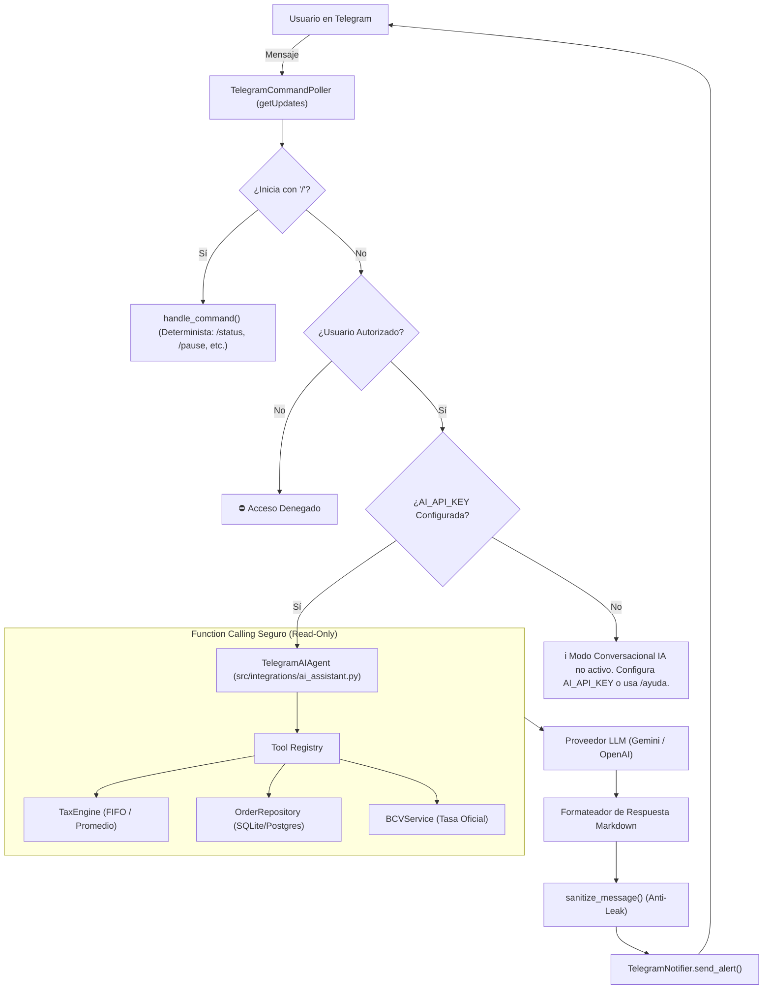

# Plan de Arquitectura 012: Asistente de IA para Consultas Naturales en Telegram

## 1. Diagrama de Flujo y Componentes

## 2. Componentes a Implementar

### A. Módulo de Configuración (`config/settings.py`)
- `AI_PROVIDER: str = "gemini"` (soporte para `gemini` y `openai`).
- `AI_API_KEY: str = ""` (token de la API de IA).
- `AI_MODEL_NAME: str = "gemini-2.0-flash"` (modelo por defecto de alta velocidad y bajo costo).

### B. Módulo del Asistente (`src/integrations/ai_assistant.py`)
- Clase `TelegramAIAgent`:
  - Recibe la sesión de base de datos (`SessionLocal`), el repositorio de órdenes y el motor fiscal.
  - Expone funciones decoradas como herramientas de consulta:
    - `get_metrics(days_back: int = 7)`
    - `get_orders(limit: int = 5)`
    - `get_bcv()`
    - `get_system_status()`
  - Implementa cliente HTTP ligero hacia Gemini API (`v1beta/models/gemini-2.0-flash:generateContent`) o SDK oficial.

### C. Integración en `TelegramCommandPoller` (`src/integrations/telegram_notifier.py`)
- Si el mensaje de texto no inicia con `/`, delegar en `self.ai_agent.ask(user_id, text)`.

### D. Seguridad y Límites de Tokens
- Tamaño máximo del mensaje de entrada del usuario (ej. 300 caracteres) para evitar ataques de prompt injection.
- Timeout estricto de 10 segundos para llamadas a la IA.
