# Plan de Implementación: SPEC-013

## 1. Arquitectura y Componentes Afectados

```mermaid
flowchart TD
    subgraph GoogleSheets["1. Google Sheets & Diagnóstico"]
        A1["SheetsExporter (src/reporting/sheets_exporter.py)"] -->|last_error + client_email| A2["TelegramNotifier (_handle_sheets_sync)"]
        A1 --> A3["Dashboard Streamlit (tab_tax)"]
    end

    subgraph VPS["2. Infraestructura VPS & IP Fija"]
        B1["scripts/deploy_vps.sh"] --> B2["docker/docker-compose.yml"]
        B3["StartupPermissionValidator (src/security/permissions.py)"] --> B4["Auto-Detección IP Pública"]
    end

    subgraph Stitch["3. Google Stitch MCP UI"]
        C1["mcp_config.json (stitch server)"] --> C2["Tokens de Diseño & Estilos"]
        C2 --> C3["Componentes Streamlit / UI"]
    end

    subgraph Monitors["4. Monitores Inteligentes"]
        D1["SpreadMonitor (src/core/spread_monitor.py)"] --> D2["Alertas Telegram"]
        D3["MonthlyTaxReporter (src/reporting/monthly_reporter.py)"] --> D2
    end
```

---

## 2. Fases de Ejecución

### Fase 1: Diagnóstico Detallado y Corrección Inmediata de Google Sheets
- Actualizar `SheetsExporter`:
  - Campo `self.last_error: str | None`.
  - Campo `self.client_email: str | None` extraído del bloque de credenciales JSON.
  - Captura y categorización de excepciones de Google API (HTTP 403, HTTP 404, credenciales faltantes).
- Refactorizar `_handle_sheets_sync()` en `telegram_notifier.py` para devolver el error amigable con el email exacto.
- Añadir pruebas unitarias en `tests/unit/test_sheets_exporter.py`.

### Fase 2: Automatización y Scripts de Despliegue en VPS
- Crear `scripts/deploy_vps.sh` con verificación de Docker, Docker Compose, variables de entorno y validación de IPv4 fija.
- Añadir servicio de detección de IP pública saliente (`https://api.ipify.org`) al iniciar el motor para confirmar la coincidencia con la whitelist de Binance.

### Fase 3: Integración de Google Stitch MCP
- Configurar servidor MCP de Stitch en `C:\Users\jonan\.gemini\config\mcp_config.json`.
- Enriquecer la interfaz de Streamlit (`src/reporting/dashboard/`) con estilos modernos, glassmorphism y métricas fintech inspiradas en Stitch.

### Fase 4: Monitores Proactivos (Spread BCV vs P2P y Reporte Mensual)
- Implementar `SpreadMonitor` en `src/core/`.
- Programar despachador de reportes mensuales en `src/reporting/`.
