# Plan de Implementación: SPEC-013

## 1. Arquitectura y Componentes Afectados

```mermaid
flowchart TD
    subgraph GoogleSheets["1. Google Sheets & Diagnóstico"]
        A1["SheetsExporter (src/reporting/sheets_exporter.py)"] -->|last_error + client_email| A2["TelegramNotifier (_handle_sheets_sync)"]
        A1 --> A3["Dashboard Streamlit (tab_tax)"]
    end

    subgraph VPS["2. Infraestructura VPS & IP Fija"]
        B1["scripts/deploy_vps.sh"] --> B2["docker/docker-compose.yml"]
        B3["StartupPermissionValidator (src/security/permissions.py)"] --> B4["Auto-Detección IP Pública"]
    end

    subgraph Stitch["3. Google Stitch MCP UI"]
        C1["mcp_config.json (stitch server)"] --> C2["Tokens de Diseño & Estilos"]
        C2 --> C3["Componentes Streamlit / UI"]
    end

    subgraph Monitors["4. Monitores Inteligentes"]
        D1["SpreadMonitor (src/core/spread_monitor.py)"] --> D2["Alertas Telegram"]
        D3["MonthlyTaxReporter (src/reporting/monthly_reporter.py)"] --> D2
    end
```

---

## 2. Fases de Ejecución

### Fase 1: Diagnóstico Detallado y Corrección Inmediata de Google Sheets
- Actualizar `SheetsExporter`:
  - Campo `self.last_error: str | None`.
  - Campo `self.client_email: str | None` extraído del bloque de credenciales JSON.
  - Captura y categorización de excepciones de Google API (HTTP 403, HTTP 404, credenciales faltantes).
- Refactorizar `_handle_sheets_sync()` en `telegram_notifier.py` para devolver el error amigable con el email exacto.
- Añadir pruebas unitarias en `tests/unit/test_sheets_exporter.py`.

### Fase 2: Automatización y Scripts de Despliegue en VPS
- Crear `scripts/deploy_vps.sh` con verificación de Docker, Docker Compose, variables de entorno y validación de IPv4 fija.
- Añadir servicio de detección de IP pública saliente (`https://api.ipify.org`) al iniciar el motor para confirmar la coincidencia con la whitelist de Binance.

### Fase 3: Integración de Google Stitch MCP y Modernización de UI (Terminal P2P)
- **Configuración MCP**:
  - Registrar el servidor MCP de Google Stitch en `C:\Users\jonan\.gemini\config\mcp_config.json`.
  - Crear guía de integración y sincronización de diseño en `docs/stitch_mcp_setup.md`.
- **Motor de Temas y Tokens de Diseño Stitch (`src/reporting/dashboard/theme.py`)**:
  - Paleta Obsidian Fintech: Fondo `#0B0E14`, superficie `rgba(22, 27, 34, 0.75)`, acentos `#10B981` (verde), `#F43F5E` (rojo), `#06B6D4` (cian), `#F59E0B` (ámbar).
  - Estilos Glassmorphism: Tarjetas translúcidas con `backdrop-filter: blur(16px)`, bordes sutiles y números tabulares (`font-variant-numeric: tabular-nums`).
  - Badges semánticos para estados: `MATCHED`, `UNMATCHED`, `BALANCED`, `DISCREPANCY`.
- **Componentes Modulares (`src/reporting/dashboard/components/`)**:
  - `terminal_header.py`: Barra superior de telemetría operativa en vivo (Modo Fail-closed, conexión Binance, IP pública y uso de cuota `x-mbx-used-weight`).
  - `kpi_cards.py`: Tarjetas reactivas de resumen financiero y contable.
  - `receipt_center.py`: Centro interactivo de comprobantes bancarios con tabla de conciliación, filtros y widget de carga directa (OCR Memory-only).
  - `ai_telemetry.py`: Monitor interactivo del pool de claves de IA (Gemini Vision) con estado de cuota y tiempos de respuesta.
- **Integración en Dashboard Maestro (`src/reporting/dashboard/app.py`)**:
  - Inyección del tema Stitch e integración de componentes en las vistas principales.
  - Apego estricto a estándares Streamlit 2026: sin `use_container_width`, uso de `width="stretch"`, `st.container(border=True)` e iconos Material Symbols.
- **Auditoría de Seguridad y Pruebas**:
  - Cero persistencia en disco de comprobantes cargados desde la UI.
  - Sanitización estricta de HTML/CSS para prevenir XSS.
  - Pruebas unitarias para `theme.py` y componentes.

### Fase 4: Monitores Proactivos (Spread BCV vs P2P y Reporte Mensual)
- Implementar `SpreadMonitor` en `src/core/`.
- Programar despachador de reportes mensuales en `src/reporting/`.
