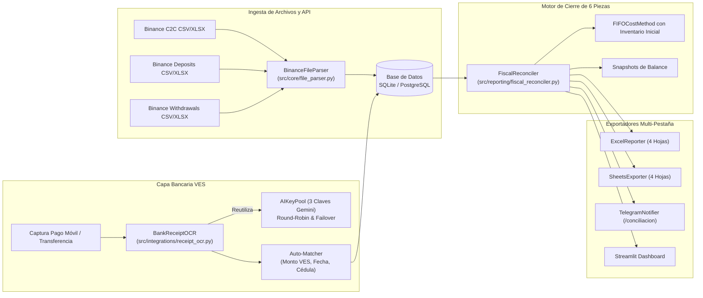

# Plan de Arquitectura Técnica: SPEC-014 (Reconstrucción Fiscal P2P y OCR Bancario)

## 1. ARQUITECTURA GENERAL Y FLUJO DE COMPONENTES



---

## 2. MODELOS DE DATOS SQLALCHEMY (`src/data/models.py`)

### A. Modelo `WalletMovement`
Registra movimientos de entrada y salida on-chain de criptoactivos:
```python
class WalletMovement(Base):
    __tablename__ = "wallet_movements"
    id = Column(Integer, primary_key=True, autoincrement=True)
    movement_type = Column(String(20), nullable=False) # DEPOSIT, WITHDRAWAL
    asset = Column(String(20), nullable=False)        # USDT, BTC
    amount = Column(Float, nullable=False)
    fee = Column(Float, default=0.0, nullable=False)
    network = Column(String(30), nullable=True)       # TRC20, BSC, MATIC
    txid = Column(String(128), unique=True, index=True, nullable=True)
    address = Column(String(128), nullable=True)
    status = Column(String(30), nullable=False)       # Success, Completed
    timestamp = Column(DateTime, nullable=False)
    created_at = Column(DateTime, default=lambda: datetime.now(UTC))
```

### B. Modelo `BankVoucher`
Registra comprobantes de pago en bolívares extraídos por OCR o ingresados:
```python
class BankVoucher(Base):
    __tablename__ = "bank_vouchers"
    id = Column(Integer, primary_key=True, autoincrement=True)
    bank_name = Column(String(100), nullable=False)   # Banco de Venezuela, Banesco, etc.
    reference_number = Column(String(50), nullable=False, index=True)
    amount_ves = Column(Float, nullable=False)
    sender_id = Column(String(20), nullable=True)     # Cédula V-12345678
    sender_name = Column(String(255), nullable=True)
    payment_method = Column(String(30), default="PAGO_MOVIL")
    associated_order_number = Column(String(50), nullable=True, index=True)
    verification_status = Column(String(30), default="MATCHED") # MATCHED, UNMATCHED, PENDING
    voucher_date = Column(DateTime, nullable=True)
    created_at = Column(DateTime, default=lambda: datetime.now(UTC))
```

### C. Modelo `FiscalPeriodSnapshot`
Persiste los snapshots mensuales de balance y la reconciliación de 6 piezas:
```python
class FiscalPeriodSnapshot(Base):
    __tablename__ = "fiscal_period_snapshots"
    id = Column(Integer, primary_key=True, autoincrement=True)
    period = Column(String(7), unique=True, index=True, nullable=False) # YYYY-MM
    initial_balance = Column(Float, default=0.0, nullable=False)
    inflows_deposits = Column(Float, default=0.0, nullable=False)
    inflows_p2p_buys = Column(Float, default=0.0, nullable=False)
    outflows_withdrawals = Column(Float, default=0.0, nullable=False)
    outflows_p2p_sells = Column(Float, default=0.0, nullable=False)
    volume_operated = Column(Float, default=0.0, nullable=False)
    total_fees = Column(Float, default=0.0, nullable=False)
    calculated_final_balance = Column(Float, nullable=False)
    actual_final_balance = Column(Float, nullable=False)
    discrepancy = Column(Float, default=0.0, nullable=False)
    gross_revenue_ves = Column(Float, default=0.0, nullable=False)
    acquisition_cost_ves = Column(Float, default=0.0, nullable=False)
    net_profit_ves = Column(Float, default=0.0, nullable=False)
    net_profit_usd = Column(Float, default=0.0, nullable=False)
    status = Column(String(30), default="BALANCED")   # BALANCED, DISCREPANCY
    created_at = Column(DateTime, default=lambda: datetime.now(UTC))
```

---

## 3. COMPONENTES Y SERVICIOS

### A. Parser de Archivos Binance (`src/core/file_parser.py`)
- Detecta si el archivo es CSV o Excel (`.xlsx`).
- Localiza automáticamente la fila de encabezados buscando palabras clave (`Número de Pedido`, `Order Number`, `Hora`, `Time`).
- Normaliza nombres de columnas tanto en español como en inglés.
- Transforma los datos en modelos `Order` y `WalletMovement` con inserción idempotente (`ON CONFLICT DO NOTHING`).

### B. Servicio OCR Bancario con Gemini Vision (`src/integrations/receipt_ocr.py`)
- Se apoya en `AIKeyPool` configurado en `src/integrations/ai_assistant.py` (3 claves API con balanceo round-robin de 45 RPM).
- Convierte la imagen a Base64 e invoca `models/gemini-2.0-flash:generateContent` con modo JSON schema forzado:
  ```json
  {
    "type": "OBJECT",
    "properties": {
      "bank_name": {"type": "STRING"},
      "reference_number": {"type": "STRING"},
      "amount_ves": {"type": "NUMBER"},
      "sender_cedula": {"type": "STRING"},
      "sender_name": {"type": "STRING"},
      "date_time": {"type": "STRING"},
      "payment_method": {"type": "STRING", "enum": ["PAGO_MOVIL", "TRANSFERENCIA"]}
    },
    "required": ["bank_name", "reference_number", "amount_ves"]
  }
  ```
- Función de coincidencia `match_with_orders()` que vincula el comprobante a órdenes pendientes dentro de una ventana de $\pm 24\text{ horas}$ y tolerancia de $\pm 0.05\text{ VES}$.

### C. Motor Fiscal de 6 Piezas (`src/reporting/fiscal_reconciler.py`)
- Ejecuta la agregación mensual del período seleccionado.
- Calcula el inventario inicial, sumatoria de entradas (depósitos + compras), salidas (retiros + ventas) y saldo teórico final.
- Ejecuta el motor FIFO valorando lotes de saldo inicial a la tasa oficial BCV del primer día del mes.
- Genera el objeto de métricas consolidado `FiscalReconciliationResult`.

### D. Exportadores Multi-Pestaña (`excel_reporter.py` y `sheets_exporter.py`)
- **ExcelReporter**: Escribe las 4 hojas con estilos formateados de moneda, colores en encabezados y fórmulas de suma.
- **SheetsExporter**: Crea o sincroniza las 4 pestañas en la hoja de Google Drive del usuario mediante `gspread`.

---

## 4. EVALUACIÓN DE CAPACIDAD: 3 CLAVES GEMINI PARA OCR
- **Cuota de Gemini 2.0 Flash / 1.5 Flash**: 15 peticiones por minuto (RPM) y 1,500 peticiones por día por clave.
- **Con 3 Claves en AIKeyPool**:
  - $15 \times 3 = 45\text{ comprobantes por minuto}$.
  - $1,500 \times 3 = 4,500\text{ comprobantes por día}$.
- **Conclusión de Capacidad**: Es **completamente viable y más que suficiente** para un comerciante P2P de alto volumen (que típicamente procesa entre 20 y 200 órdenes diarias). No se requieren claves adicionales.
