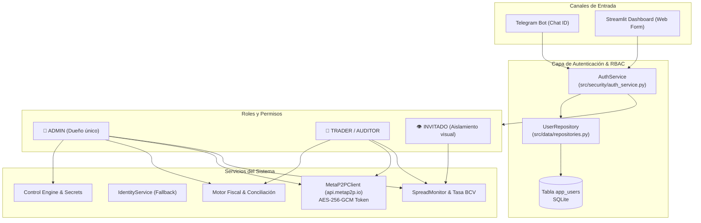

# Plan de Arquitectura Técnica: SPEC-015 (Multi-usuario, RBAC y MetaP2P)

## 1. ARQUITECTURA GENERAL Y FLUJO DE AUTENTICACIÓN



---

## 2. MODELO DE DATOS SQLALCHEMY (`src/data/models.py`)

### Modelo `User`
```python
class User(Base):
    __tablename__ = "app_users"

    id = Column(Integer, primary_key=True, autoincrement=True)
    username = Column(String(50), unique=True, index=True, nullable=False)
    password_hash = Column(String(255), nullable=False)
    telegram_id = Column(String(50), unique=True, index=True, nullable=True)
    role = Column(String(20), default="INVITADO", nullable=False)  # ADMIN, TRADER, INVITADO
    is_active = Column(Boolean, default=True, nullable=False)
    created_at = Column(DateTime, default=lambda: datetime.now(UTC), nullable=False)
```

---

## 3. SERVICIO DE AUTENTICACIÓN Y SEGURIDAD (`src/security/auth_service.py`)

1. **Hashing de Contraseñas**:
   - Algoritmo: PBKDF2-HMAC-SHA256 con salt criptográfico de 16 bytes y 100,000 iteraciones (módulo estándar `hashlib` y `secrets` para garantizar cero fallos de compilación en Windows/Linux).
   - Formato de almacenamiento: `pbkdf2_sha256$100000$salt_hex$hash_hex`.
2. **Control de Sesiones**:
   - Generación de tokens de sesión con HMAC y expiración configurable (por defecto 12 horas).
3. **Inicialización Fail-Closed**:
   - Si no existe ningún usuario `ADMIN` en `app_users`, se crea automáticamente el usuario `admin` vinculado al `TELEGRAM_ALERT_CHAT_ID` / `TELEGRAM_ALLOWED_USER_IDS` con una contraseña temporal de primer uso reportada en logs de arranque.

---

## 4. INTEGRACIÓN DE METAP2P (`src/integrations/metap2p_client.py`)

1. **Gestión de Credenciales**:
   - `metap2p_email` y `metap2p_password` se almacenan cifradas con AES-256-GCM en `encrypted_secrets` mediante `ApiKeyManager`.
2. **Ciclo de Sesión en Memoria**:
   - Atributos volátiles `_access_token` y `_token_expiry`.
   - Método `login()` ejecuta `POST https://api.metap2p.io/api/login` y almacena el token en memoria.
   - Si una llamada a `GET /api/dni/search?dni={cedula}` retorna `HTTP 401`, se renueva el token y se reintenta automáticamente una vez.
3. **Mapeo a `IdentityInfo`**:
   - Convierte el JSON recibido al formato estándar de `IdentityInfo` de nuestro sistema:
     ```python
     IdentityInfo(
         nationality=data.get("dni_prefix", "V"),
         cedula=data.get("dni_number", dni),
         full_name=data.get("full_name", "").strip(),
         is_valid=True,
         source="METAP2P"
     )
     ```
4. **Integración en `IdentityService`**:
   - Cascada: 1) Caché local SQLite, 2) MetaP2P API, 3) SENIAT XML, 4) CNE Ciudadano.

---

## 5. AISLAMIENTO Y EXPERIENCIA EN TELEGRAM

1. **Aislamiento Visual de Teclado**:
   - Para `INVITADO`:
     `get_persistent_menu_markup(role="INVITADO")` retorna:
     ```json
     {
       "keyboard": [
         [{"text": "📈 Spreads P2P"}, {"text": "🏛️ Tasa BCV"}],
         [{"text": "❓ Ayuda"}]
       ],
       "resize_keyboard": true
     }
     ```
   - Para `TRADER` y `ADMIN`:
     Retorna el menú completo con `[📊 Estado]`, `[⚖️ Conciliación]`, `[🔄 Sheets]`.
2. **Restricción de Comandos en `handle_command`**:
   - Se consulta el rol del remitente vía `telegram_id`.
   - Si es `INVITADO` y el comando no está en `["/start", "/help", "/ayuda", "/spread", "/bcv", "📈 spreads p2p", "🏛️ tasa bcv", "❓ ayuda"]`:
     Retornar: `⛔ Opción reservada para Traders y Administradores.`
3. **Flujo de Aprobación**:
   - Si no está registrado:
     - El bot le responde: `👋 Hola! Tu Telegram ID es: {user_id}. Se ha enviado una solicitud al Administrador.`
     - El bot envía al Admin: `👤 Nueva solicitud de acceso de ID {user_id}` con botones inline:
       `[✅ Aprobar Invitado] [💼 Aprobar Trader] [⛔ Bloquear]`
4. **Comandos de Gestión del Admin**:
   - `/usuarios`: Lista interactiva.
   - `/autorizar <id> <ROL>`: Asignación inmediata.
   - `/revocar <id>`: Desactivación inmediata.

---

## 6. ESTRATEGIA DE PRUEBAS (TDD)

1. `tests/unit/test_auth_service.py`:
   - Hashing y verificación de contraseñas.
   - Seeding del Administrador principal.
   - Validación de roles y permisos.
2. `tests/unit/test_metap2p_client.py`:
   - Mock de `POST /login` y obtención de `access_token`.
   - Mock de `GET /dni/search` exitoso, no encontrado (`RECORD_NOT_FOUND`) y token expirado (`401`).
   - Integración con `IdentityService` y fallback.
3. `tests/unit/test_telegram_rbac.py`:
   - Pruebas de aislamiento para `INVITADO` (bloqueo de `/cedula`, `/status`, `/pause`).
   - Aprobación dinámica mediante callbacks de Telegram.
   - Generación de teclados según rol.
