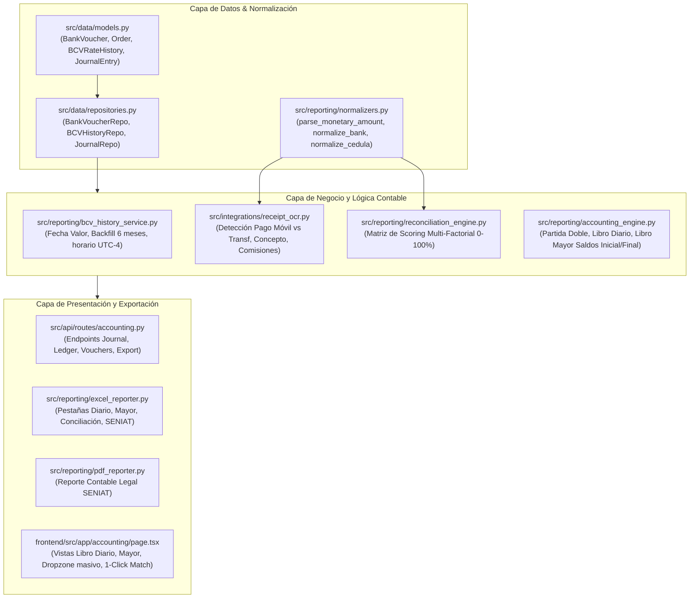

# PLAN-017: Arquitectura y Diseño Técnico — Motor Contable P2P

## 1. Arquitectura de Módulos



---

## 2. Modelos de Base de Datos (SQLAlchemy)

### 2.1 Actualización de `BankVoucher`
```python
class BankVoucher(Base):
    __tablename__ = "bank_vouchers"
    id = Column(Integer, primary_key=True, autoincrement=True)
    bank_name = Column(String(100), nullable=False)
    destination_bank = Column(String(100), nullable=True)
    reference_number = Column(String(50), index=True, nullable=False)
    amount_ves = Column(Float, nullable=False)           # Monto neto comercial
    bank_fee_ves = Column(Float, default=0.0, nullable=False) # Comisión bancaria
    total_debited_ves = Column(Float, default=0.0, nullable=False) # Monto total debitado
    sender_id = Column(String(20), nullable=True)        # Cédula o S/C
    sender_name = Column(String(255), nullable=True)
    sender_phone = Column(String(30), nullable=True)     # Teléfono o N/A
    concept = Column(String(255), nullable=True)         # Motivo/concepto del capture
    payment_method = Column(String(30), default="PAGO_MOVIL", nullable=False) # PAGO_MOVIL | TRANSFERENCIA
    movement_type = Column(String(20), default="DEBIT", nullable=False)       # DEBIT | CREDIT
    associated_order_number = Column(String(50), nullable=True, index=True)
    verification_status = Column(String(30), default="UNMATCHED", nullable=False) # MATCHED, UNMATCHED, PENDING
    reconciliation_score = Column(Float, default=0.0, nullable=False)
    voucher_date = Column(DateTime, nullable=True)
    created_at = Column(DateTime, default=lambda: datetime.now(UTC), nullable=False)
```

### 2.2 Actualización de `Order`
Añadir columnas:
- `completed_at = Column(DateTime, nullable=True)`
- `payment_method = Column(String(50), nullable=True)`

### 2.3 Nuevo Modelo: `BCVRateHistory`
```python
class BCVRateHistory(Base):
    __tablename__ = "bcv_rates_history"
    fecha_valor = Column(Date, primary_key=True, index=True) # YYYY-MM-DD oficial
    usd_rate = Column(Float, nullable=False)
    eur_rate = Column(Float, default=0.0, nullable=False)
    source = Column(String(50), default="BCV_OFFICIAL", nullable=False)
    created_at = Column(DateTime, default=lambda: datetime.now(UTC), nullable=False)
```

### 2.4 Nuevo Modelo: `JournalEntry`
```python
class JournalEntry(Base):
    __tablename__ = "journal_entries"
    id = Column(Integer, primary_key=True, autoincrement=True)
    entry_number = Column(Integer, index=True, nullable=False)
    date_time = Column(DateTime, index=True, nullable=False)
    account_code = Column(String(30), nullable=False)   # 1.1.01, 1.1.05, 5.2.01, etc.
    account_name = Column(String(100), nullable=False)
    debit = Column(Float, default=0.0, nullable=False)
    credit = Column(Float, default=0.0, nullable=False)
    reference = Column(String(50), nullable=False)
    description = Column(Text, nullable=False)
    voucher_id = Column(Integer, nullable=True)
    order_number = Column(String(50), nullable=True)
    prev_hash = Column(String(64), nullable=True)
    entry_hash = Column(String(64), nullable=False)
```

---

## 3. Lógica del Algoritmo de Conciliación Multi-Factorial

```python
def calculate_match_score(voucher: BankVoucher, order: Order) -> float:
    # 1. Hard Filter: Flujo
    if voucher.movement_type == "DEBIT" and order.trade_type != "BUY":
        return 0.0
    if voucher.movement_type == "CREDIT" and order.trade_type != "SELL":
        return 0.0

    # 2. Hard Filter: Ventana horaria (± 30 min para inmediatas, 48h para ACH)
    diff_sec = abs((voucher.voucher_date - order.created_at).total_seconds())
    if voucher.payment_method == "TRANSFERENCIA" and diff_sec > 172800: # 48 horas
        return 0.0
    if voucher.payment_method == "PAGO_MOVIL" and diff_sec > 1800:      # 30 minutos
        return 0.0

    score = 0.0
    # Monto exacto (30%)
    if abs(voucher.amount_ves - order.fiat_amount) <= 0.05:
        score += 30.0

    # Referencia bancaria en chat o número de orden (40%)
    clean_ref = normalize_reference(voucher.reference_number)
    if clean_ref in str(order.order_number) or clean_ref in str(order.counterparty_name):
        score += 40.0

    # Banco / Método de Pago (30%)
    if voucher.bank_name in str(order.payment_method):
        score += 30.0

    # Coincidencia parcial de nombre (Bonus 15%)
    if voucher.sender_name and order.counterparty_name:
        if normalize_text(order.counterparty_name) in normalize_text(voucher.sender_name):
            score += 15.0

    return min(100.0, score)
```

---

## 4. Estructura del Libro Mayor y Ecuación Patrimonial

Para el mes $M$:
- $\text{Saldo Inicial Banco (VES)} + \sum \text{Cobros Ventas P2P} - \sum \text{Pagos Compras P2P} - \sum \text{Comisiones Bancarias} = \text{Saldo Final Banco (VES)}$
- $\text{Saldo Inicial USDT} + \sum \text{Compras USDT} - \sum \text{Ventas USDT} - \sum \text{Comisiones Binance} = \text{Saldo Final USDT}$
- $\text{Saldo Final}_{M} \equiv \text{Saldo Inicial}_{M+1}$
